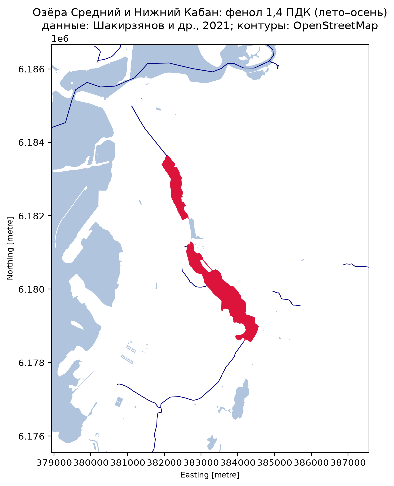
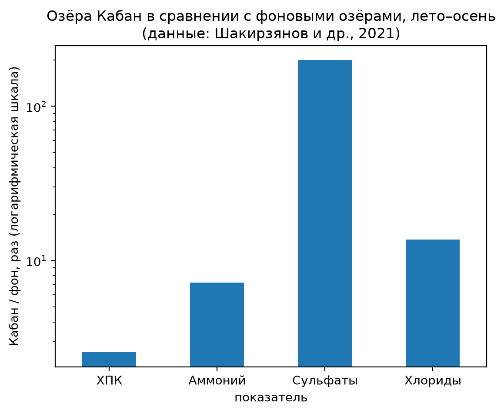

# Water bodies of Kazan and pollution of the Kaban lakes

A small GIS and data-analysis project: mapping the water bodies of Kazan, Russia,
and comparing hydrochemical indicators of the central Kaban lakes with background lakes.

## Data
- Water body outlines: OpenStreetMap (© OpenStreetMap contributors, ODbL), downloaded with osmnx.
- Hydrochemical indicators (2014–2020 averages): Shakirzyanov A.M., Petrova D.I.,
  Sofinskaya O.A. (2021). Assessment of the ecological state of Kazan surface waters.
  Georesursy, 23(4), 70–75. https://doi.org/10.18599/grs.2021.4.1

## What was done
- Downloaded and cleaned the water bodies of Kazan (lakes and rivers).
- Calculated areas and lengths in a metric projection (EPSG:32639).
- Treated the Kuibyshev Reservoir separately: the city boundary includes part of it
  and would distort the total. Other water bodies: [15,2] km². Rivers and streams: [336,7] km.
- Compared the Kaban lakes with background lakes (summer–autumn averages).
- Mapped the Kaban lakes with phenol exceeding the maximum permissible concentration (1.4 MPC).

## Limitations
- Pollution values are lake-wide averages, not point measurements.
- Water bodies without data in the paper are shown as "no data", not as clean.
- High sulfate content is attributed by the authors to local geology, not necessarily pollution.

## Files
- `kazan_water.ipynb`: analysis notebook (Python, GeoPandas, osmnx, matplotlib)
- `water.gpkg`, `kaban_pollution.gpkg`: GIS layers (open in QGIS)
- `*.png`: maps and charts

## Tools
Python, GeoPandas, osmnx, matplotlib, QGIS.
